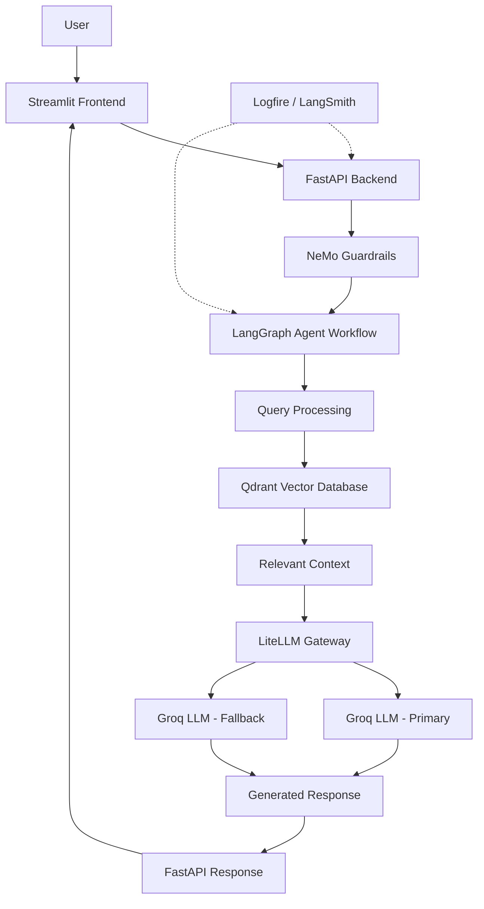
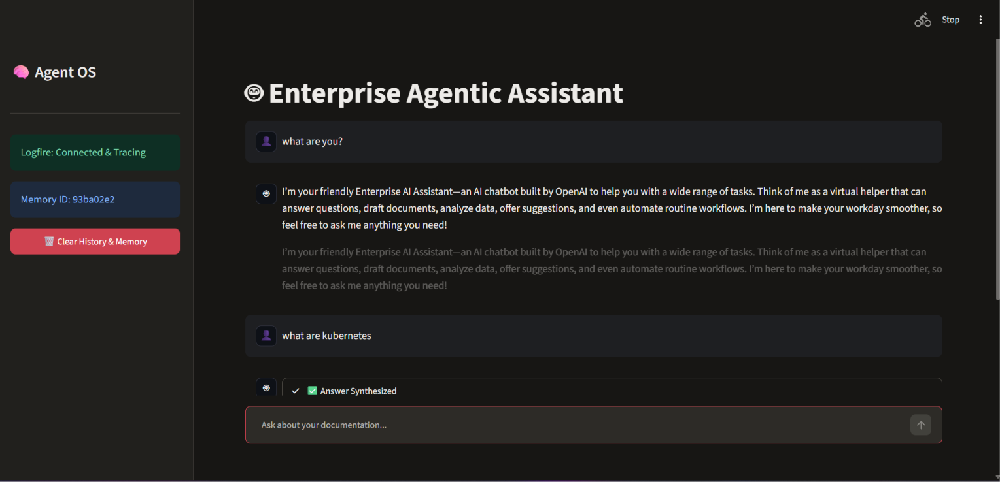
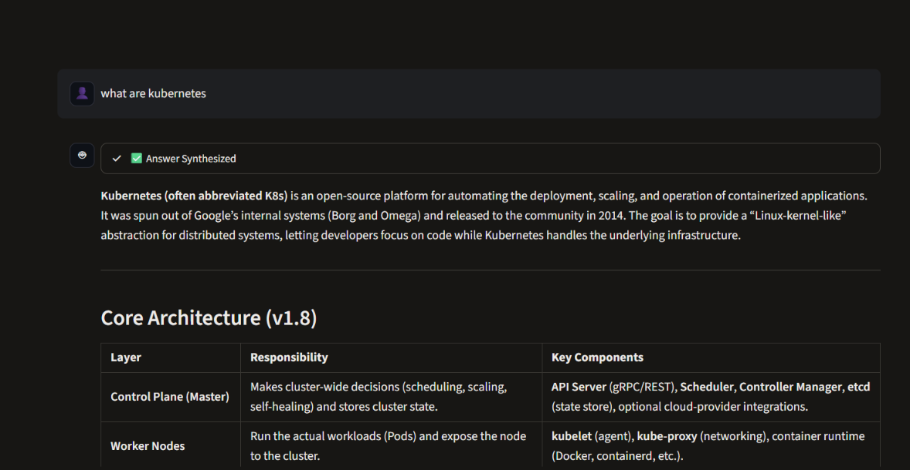

# Enterprise Agentic RAG System

An AI-powered enterprise knowledge assistant built using **Retrieval-Augmented Generation (RAG), LangGraph, FastAPI, Qdrant, LiteLLM, and NeMo Guardrails**.

The system allows users to ask questions about enterprise documentation and receive context-aware answers grounded in retrieved knowledge base content.

[🚀 Live Application](https://enterprise-rag-frontend-dpfj.onrender.com/) | [📚 API Documentation](https://enterprise-rag-backend-jrua.onrender.com/docs) | [💻 GitHub Repository](https://github.com/Saluja50/product-grade-rag-system)

---

## 🚀 Project Overview

Enterprise Agentic RAG is designed to provide an intelligent conversational interface for querying enterprise knowledge bases.

Unlike a traditional chatbot that relies only on an LLM's pretrained knowledge, this system retrieves relevant information from a vector database before generating responses.

The application combines:

- Agentic workflows for query processing.
- Semantic retrieval using a vector database.
- LLM-powered response generation.
- Guardrails for safer interactions.
- Centralized LLM access through LiteLLM.
- Observability and tracing for monitoring application behavior.

## ✨ Key Features

- **Agentic RAG Pipeline:** Uses LangGraph to coordinate query processing and response generation.
- **Semantic Search:** Retrieves relevant knowledge from Qdrant.
- **Context-Aware Answers:** Generates responses using retrieved enterprise documentation.
- **LLM Gateway:** Uses LiteLLM to centralize model access and configure fallback models.
- **AI Guardrails:** Integrates NeMo Guardrails to help handle off-topic queries and unsafe interactions.
- **Conversational Interface:** Streamlit-based chat interface with session management and chat history.
- **API Backend:** FastAPI-powered backend with interactive Swagger documentation.
- **Observability:** Logfire and LangSmith integrations for tracing and debugging.
- **Cloud Deployment:** Separately deployed frontend, backend, and LLM gateway.

## 🏗️ System Architecture



### Request Flow

1. A user submits a question through the Streamlit interface.
2. The frontend sends the query to the FastAPI backend.
3. NeMo Guardrails evaluates the incoming interaction.
4. LangGraph coordinates the agentic query-processing workflow.
5. Relevant information is retrieved from Qdrant.
6. The retrieved context is passed to the LLM through the LiteLLM gateway.
7. The configured LLM generates a context-aware response.
8. The backend returns the answer and available source information to the frontend.

## 🛠️ Technology Stack

| Component            | Technology                          |
| -------------------- | ----------------------------------- |
| Programming Language | Python                              |
| Frontend             | Streamlit                           |
| Backend              | FastAPI                             |
| Agent Orchestration  | LangGraph                           |
| LLM Framework        | LangChain                           |
| LLM Gateway          | LiteLLM                             |
| Primary LLM Provider | Groq                                |
| Language Models      | GPT-OSS 20B / GPT-OSS 120B fallback |
| Vector Database      | Qdrant                              |
| Embeddings           | Google Gemini                       |
| AI Guardrails        | NVIDIA NeMo Guardrails              |
| Observability        | Logfire                             |
| LLM Tracing          | LangSmith                           |
| Deployment           | Render                              |
| Containerization     | Docker                              |

## 🌐 Live Deployment

| Service            | URL                                                                        |
| ------------------ | -------------------------------------------------------------------------- |
| Streamlit Frontend | [Open Application](https://enterprise-rag-frontend-dpfj.onrender.com/)     |
| FastAPI Backend    | [Backend](https://enterprise-rag-backend-jrua.onrender.com/)               |
| Swagger API Docs   | [API Documentation](https://enterprise-rag-backend-jrua.onrender.com/docs) |
| LiteLLM Gateway    | [Gateway](https://enterprise-rag-litellm-gateway.onrender.com)             |

**Note:** The application uses separate deployments for the frontend, backend, and LLM gateway.


## 📸 Application Screenshots

### Application Interface


### RAG Response Generation



## 📂 Project Structure

```text
product-grade-rag-system/
│
├── app/
│   ├── agents/
│   │   └── nodes/
│   │       ├── planner.py
│   │       └── responder.py
│   │
│   ├── gateway/
│   │   └── client.py
│   │
│   ├── guardrails/
│   │   ├── rails.py
│   │   └── colang_rules.py
│   │
│   ├── ingestion/
│   │   └── processor.py
│   │
│   ├── services/
│   │   └── retrieval/
│   │       └── embedding.py
│   │
│   ├── config.py
│   └── main.py
│
├── ui/
│   └── app.py
│
├── Dockerfile
├── .dockerignore
├── .gitignore
├── requirements.txt
├── requirements-prod.txt
├── requirements-ui.txt
└── README.md
```

*The structure above highlights the main application components; additional project files and modules may exist.*

## ⚙️ Local Installation & Setup

### 1. Clone the repository

```bash
git clone https://github.com/Saluja50/product-grade-rag-system.git
cd product-grade-rag-system
```

### 2. Create a virtual environment

```bash
python -m venv venv
```

Activate it:

**Windows PowerShell**

```powershell
.\venv\Scripts\Activate.ps1
```

**Linux / macOS**

```bash
source venv/bin/activate
```

### 3. Install dependencies

```bash
pip install -r requirements.txt
```

### 4. Configure environment variables

Create a `.env` file in the project root.

Add the required credentials:

```env
# Google Gemini
GEMINI_API_KEY=your_gemini_api_key

# Qdrant
QDRANT_CLUSTER_ENDPOINT=your_qdrant_endpoint
QDRANT_API_KEY=your_qdrant_api_key

# LiteLLM Gateway
LITELLM_API_KEY=your_litellm_master_key
LITELLM_BASE_URL=https://your-litellm-gateway-url/v1

# Observability
LOGFIRE_TOKEN=your_logfire_token

# LangSmith
LANGSMITH_TRACING=true
LANGSMITH_ENDPOINT=https://api.smith.langchain.com
LANGSMITH_API_KEY=your_langsmith_api_key
LANGSMITH_PROJECT=enterprise-rag-project
```

Never commit your `.env` file or expose API keys in source code.

### 5. Start the FastAPI backend

```bash
uvicorn app.main:app --reload
```

Backend:

```text
http://127.0.0.1:8000
```

Swagger documentation:

```text
http://127.0.0.1:8000/docs
```

### 6. Start the Streamlit frontend

Open another terminal, activate the virtual environment, and run:

```bash
streamlit run ui/app.py
```

Frontend:

```text
http://localhost:8501
```

For local frontend-backend communication, the frontend defaults to:

```text
http://127.0.0.1:8000
```

You can override this using:

```env
BACKEND_URL=http://127.0.0.1:8000
```

## 🔌 API Usage

The application exposes a query endpoint through FastAPI.

**Endpoint**

```http
POST /query
```

**Example request**

```json
{
  "q": "What is Kubernetes and what are its main components?"
}
```

**Example response structure**

```json
{
  "status": "Response generated.",
  "answer": "Kubernetes is an open-source container orchestration platform...",
  "thought_process": [
    "Intent: Technical",
    "Search Term: Kubernetes main components and architecture",
    "Context Retrieved"
  ],
  "sources": []
}
```

The actual response includes retrieved source information when available.

For interactive API testing, visit:

[Swagger API Documentation](https://enterprise-rag-backend-jrua.onrender.com/docs)

## 🧠 Engineering Highlights

### 1. Agentic Workflow with LangGraph

LangGraph coordinates the application's query-processing and response-generation stages, making the workflow modular and easier to extend.

### 2. Centralized LLM Gateway

LiteLLM provides a unified interface between the application and language models.

The gateway is configured with:

- Primary model routing.
- Fallback model routing.
- Retry configuration.
- Centralized API-key management.

This reduces direct coupling between the application and individual LLM providers.

### 3. Retrieval-Augmented Generation

Qdrant stores the vector representations of knowledge base content.

When a query arrives, the retrieval pipeline searches for relevant information that can be used as context during response generation.

### 4. AI Safety with NeMo Guardrails

NeMo Guardrails adds conversational controls for handling interactions such as off-topic questions, greetings, and jailbreak attempts.

### 5. Observability

Logfire and LangSmith integrations help inspect application execution, trace LLM interactions, and debug workflow behavior.

## ☁️ Deployment Architecture

The project is deployed using separate Render services:

| Service            | Deployment                |
| ------------------ | ------------------------- |
| Frontend           | Render Web Service        |
| Backend            | Render Docker Web Service |
| LiteLLM Gateway    | Render Docker Web Service |
| Vector Database    | Qdrant Cloud              |
| LLM Provider       | Groq                      |
| Embedding Provider | Google Gemini             |

The frontend communicates with the backend through the `BACKEND_URL` environment variable.

The backend communicates with the LiteLLM gateway through `LITELLM_BASE_URL`.

## 🔐 Security Considerations

- API keys are stored in environment variables.
- Secrets are excluded from Git using `.gitignore`.
- The LiteLLM gateway uses a master key for authenticated access.
- The backend and frontend do not need direct access to the Groq API key.
- Production dependencies are separated from frontend dependencies.

## 🚧 Future Improvements

Potential areas for further development:

- Streaming responses for faster perceived response time.
- User authentication and role-based access control.
- Persistent conversation memory.
- Document-level access permissions.
- Improved retrieval evaluation and benchmarking.
- Automated testing and CI/CD workflows.
- Usage analytics and token-cost monitoring.
- More advanced query rewriting and retrieval strategies.


---

## 👨‍💻 Author

**Tushar Saluja**

Python Developer | Generative AI | Agentic AI | RAG Systems

- GitHub: https://github.com/Saluja50
- Project: https://github.com/Saluja50/product-grade-rag-system

<p align="center">
  <strong>Built to make enterprise knowledge more accessible through Agentic AI.</strong>
</p>

